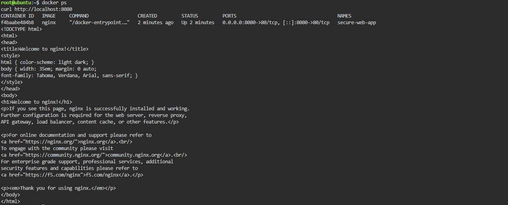

cat > README.md <<'EOF'
# Laboratory 08 - Cloud Security Engineer

## Mission Overview
In this lab I secured an Ubuntu server that was running an Nginx app with no firewall. I deployed the app in a container, turned on UFW, set the default to deny incoming traffic, and only allowed SSH (22) and the web app port (8080).

## Objectives
- Understand attack surface and the principle of least privilege
- Check the open ports on a Linux server
- Set up UFW with a default deny policy
- Allow only SSH and port 8080
- Document the firewall rules in Markdown
- Add to my GitHub Cloud Computing Portfolio

## Commands Executed
```bash
docker run -d --name secure-web-app -p 8080:80 nginx
curl http://localhost:8080
sudo ufw allow ssh
sudo ufw default deny incoming
sudo ufw default allow outgoing
sudo ufw enable
sudo ufw status verbose
sudo ufw allow 8080/tcp
sudo ufw status numbered
curl http://localhost:8080
```

## Skills Learned
- Running an Nginx container and testing it with curl
- Setting up UFW with default deny
- Allowing specific ports through the firewall
- Why SSH has to be allowed before enabling the firewall
- Closing unused ports to reduce the attack surface
- [add one thing that was new or tricky for you]

## Screenshots



## AI Disclosure
I used Claude to help draft the documentation structure. I ran all commands myself in KillerCoda and edited the text.
EOF