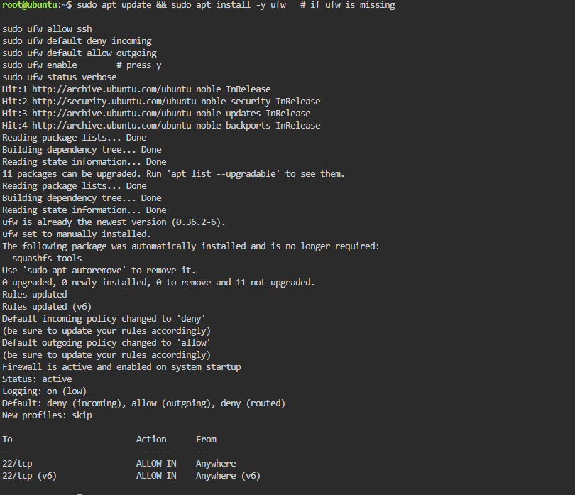
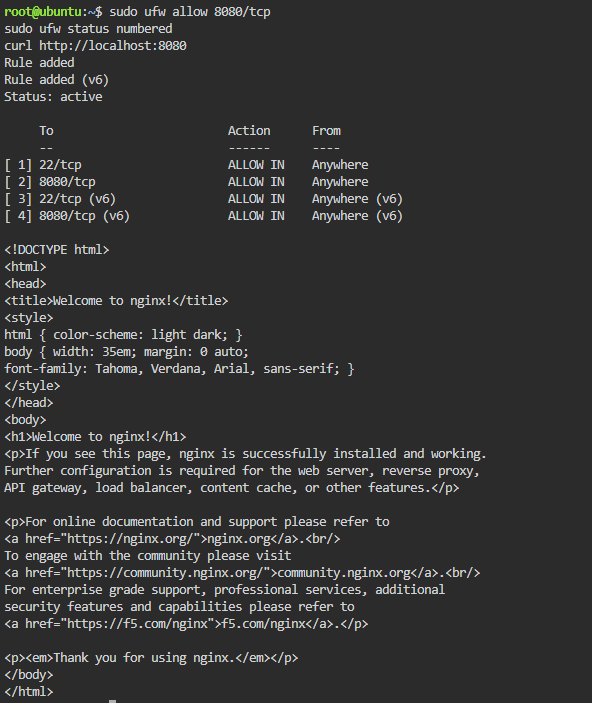

# Firewall Configuration

These are the commands I used to secure the server with UFW.

## Allow SSH
```bash
sudo ufw allow ssh
```

## Default Deny Policy
```bash
sudo ufw default deny incoming
sudo ufw default allow outgoing
```

## Enable and Check
```bash
sudo ufw enable
sudo ufw status verbose
```

## Allow Port 8080
```bash
sudo ufw allow 8080/tcp
sudo ufw status numbered
```

## What if `ufw enable` came before `ufw allow ssh`?
The firewall would block port 22 right away, so I would be locked out of my own server.

## Screenshots



