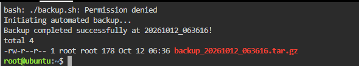
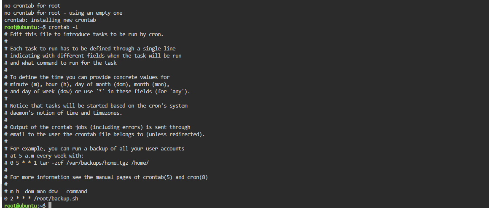

cat > README.md <<'EOF'
# Laboratory 09 - Cloud Automation Engineer

## Mission Overview
For this lab I automated a backup for a client whose staff kept forgetting to do it. I made a test folder, wrote a Bash script that compresses it into a timestamped `.tar.gz`, made the script executable, and scheduled it with cron for 2:00 AM every night.

## Objectives
- Learn the basics of Bash scripting (variables, commands)
- Write a script using nano
- Change file permissions with chmod
- Understand crontab syntax
- Document the script and schedule in Markdown
- Finish my GitHub Cloud Computing Portfolio

## Commands Executed
```bash
mkdir app-data
echo "This is critical client data." > app-data/data.txt
nano backup.sh
./backup.sh
chmod +x backup.sh
./backup.sh
ls -l backups/
crontab -l
env EDITOR=nano crontab -e
crontab -l
```

Cron entry added: `0 2 * * * /root/backup.sh`

## Skills Learned
- Writing a basic Bash script
- Using nano in the terminal
- Making a file executable with chmod
- Compressing a folder with tar
- Reading and writing a cron schedule
- [add one thing that was new or tricky for you]

## Screenshots



## AI Disclosure
I used Claude to help draft the documentation structure. I ran all commands myself in KillerCoda and edited the text.
EOF